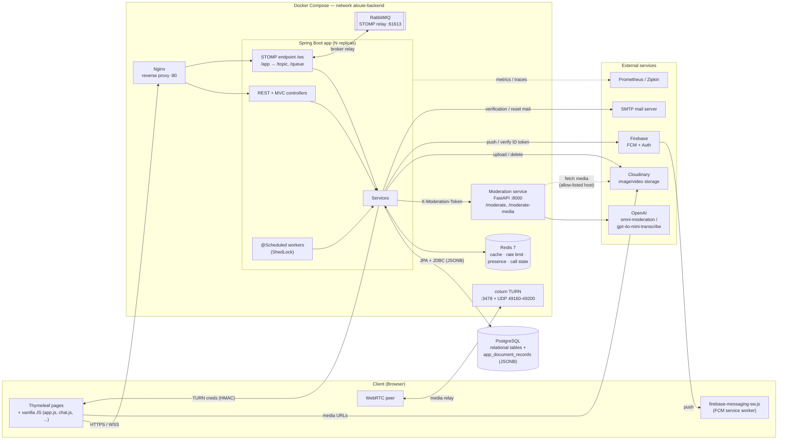
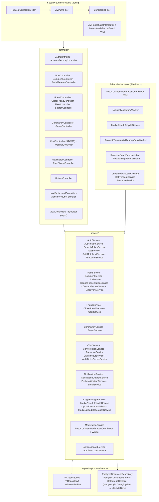
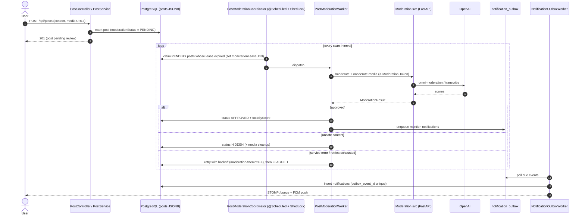

# Aloute — System Architecture & Data Model

Aloute is a social network: feed, posts, comments and reactions, reposts, communities,
1:1 and group chat, WebRTC voice/video calls, notifications and push, plus host/admin dashboards.

| Layer | Technology |
|---|---|
| Web app | Spring Boot (Web MVC, Security, WebSocket/STOMP, Thymeleaf SSR + vanilla JS) |
| Auth | JWT access token + hashed refresh tokens, TOTP 2FA, Firebase identity login |
| Primary DB | PostgreSQL. Relational tables use JPA; document aggregates are stored as JSONB in one table. Schema is managed by Flyway. |
| Cache / shared state | Redis (feed/dashboard cache, rate limits, presence leases, call state), with Caffeine as the local fallback |
| Realtime | STOMP over `/ws`, using a RabbitMQ STOMP relay when the app runs as more than one replica |
| Moderation | Python FastAPI microservice that calls the OpenAI moderation and transcription APIs |
| Media | Cloudinary |
| Push / Identity | Firebase Admin (FCM, Firebase Auth) |
| Calls | coturn TURN server with shared-secret credentials |
| Ops | Nginx, Docker Compose, ShedLock for cluster-wide scheduled jobs, Actuator + Prometheus + Zipkin |

---

## 1. Deployment / system architecture

## 2. Application internals (Spring Boot)

## 3. Async moderation flow (post creation)

---

## 4. Database diagram

PostgreSQL uses **two storage styles**:

1. **Relational tables** (JPA + Flyway) for identity, the social graph, communities, groups and notifications. These have real foreign keys.
2. **One JSONB document table**, `app_document_records(collection_name, document_id, payload jsonb)`. It holds the high-volume aggregates (posts, comments, likes, chat, and so on) that were migrated from MongoDB. Each `collection_name` is a logical entity with partial expression indexes. References from these documents to `users` are **logical only**: they are string or number IDs inside the JSON, with no FK.

### 4a. Relational schema (enforced FKs)

```mermaid
erDiagram
    roles ||--o{ users : "role_id"
    users ||--o{ refresh_tokens : "user_id (cascade)"
    users ||--o{ user_push_tokens : "user_id (cascade)"
    users ||--o{ friends : "follower_id"
    users ||--o{ friends : "followed_id"
    users ||--o{ close_friends : "requester_id"
    users ||--o{ close_friends : "receiver_id"
    users ||--o{ notifications : "receiver_id"
    users |o--o{ notifications : "sender_id (set null)"
    users ||--o{ chat_groups : "created_by"
    chat_groups ||--o{ group_members : "group_id (cascade)"
    users ||--o{ group_members : "user_id (cascade)"
    chat_groups ||--o{ group_read_status : "group_id (cascade)"
    users ||--o{ group_read_status : "user_id (cascade)"
    users ||--o{ communities : "created_by"
    communities ||--o{ community_members : "community_id (cascade)"
    users ||--o{ community_members : "user_id (cascade)"
    notification_outbox ||--o| notifications : "outbox_event_id"
    communities ||..o| community_cleanup_jobs : "community_id (no FK)"
    users ||..o{ account_admin_audit : "user_id / actor_id (no FK)"

    roles {
        bigserial id PK
        varchar name UK "ROLE_USER, ROLE_ADMIN, ROLE_HOST"
    }
    users {
        bigserial id PK
        varchar username UK "case-insensitive"
        varchar email UK
        varchar password
        varchar full_name
        varchar avatar_url
        varchar cover_url
        varchar bio
        boolean is_private
        bigint role_id FK
        boolean is_active
        boolean self_deactivated
        timestamptz tokens_revoked_at
        boolean email_verified
        varchar verification_token
        varchar reset_password_token "sha256 hex"
        timestamp reset_password_expiry
        timestamp created_at
        timestamp updated_at
    }
    pending_users {
        bigserial id PK
        varchar username UK
        varchar email UK
        varchar password
        varchar full_name
        varchar verification_token UK
        timestamp verification_token_expiry
        timestamp expires_at
        timestamp created_at
    }
    refresh_tokens {
        bigserial id PK
        bigint user_id FK
        varchar token_hash UK
        timestamptz created_at
        timestamptz expires_at
        timestamptz revoked_at
    }
    user_push_tokens {
        bigserial id PK
        bigint user_id FK
        varchar fid UK "Firebase Installation ID"
        timestamp created_at
        timestamp updated_at
    }
    friends {
        bigserial id PK
        bigint follower_id FK
        bigint followed_id FK
        timestamp created_at
    }
    close_friends {
        bigserial id PK
        bigint requester_id FK
        bigint receiver_id FK
        varchar status "PENDING/ACCEPTED"
        timestamp created_at
        timestamp responded_at
    }
    notifications {
        bigserial id PK
        bigint receiver_id FK
        bigint sender_id FK
        varchar type
        varchar reference_id
        varchar content
        boolean is_read
        varchar outbox_event_id UK
        timestamp created_at
    }
    notification_outbox {
        varchar id PK "UUID"
        bigint receiver_id
        bigint sender_id
        varchar notification_type
        varchar reference_id
        varchar content
        varchar status "PENDING/FAILED"
        int attempt_count
        varchar last_error
        timestamp next_attempt_at
        timestamp failed_at
        timestamp created_at
    }
    chat_groups {
        bigserial id PK
        varchar name
        varchar avatar_url
        bigint created_by FK
        timestamp created_at
    }
    group_members {
        bigserial id PK
        bigint group_id FK
        bigint user_id FK
        varchar role "ADMIN/MEMBER"
        timestamp joined_at
    }
    group_read_status {
        bigserial id PK
        bigint group_id FK
        bigint user_id FK
        timestamp last_read_at
    }
    communities {
        bigserial id PK
        varchar name
        varchar description
        varchar avatar_url
        varchar cover_url
        varchar privacy "PUBLIC/PRIVATE"
        bigint created_by FK
        int member_count
        timestamp created_at
    }
    community_members {
        bigserial id PK
        bigint community_id FK
        bigint user_id FK
        varchar role "OWNER/MANAGER/MEMBER/PENDING"
        timestamp joined_at
    }
    community_cleanup_jobs {
        bigint community_id PK
        varchar avatar_url
        varchar cover_url
        int attempt_count
        varchar last_error
        timestamp next_attempt_at
    }
    account_admin_audit {
        bigserial id PK
        bigint user_id
        bigint actor_id
        varchar action
        varchar reason
        timestamptz created_at
    }
    shedlock {
        varchar name PK
        timestamp lock_until
        timestamp locked_at
        varchar locked_by
    }
```

### 4b. JSONB document collections (in `app_document_records`, logical references)

Dotted lines are logical references inside the JSON payload. PostgreSQL does not enforce them; the application keeps them consistent through cleanup and reconciliation workers.

```mermaid
erDiagram
    app_document_records {
        varchar collection_name PK
        varchar document_id PK
        jsonb payload
        timestamptz created_at
        timestamptz updated_at
    }

    users ||..o{ posts : "userId"
    communities |o..o{ posts : "communityId"
    posts |o..o{ posts : "repostOfId"
    posts ||..o{ comments : "postId"
    comments |o..o{ comments : "parentCommentId"
    comments ||..o{ comment_reactions : "commentId"
    users ||..o{ comment_reactions : "userId"
    posts ||..o{ likes : "postId"
    users ||..o{ likes : "userId"
    posts ||..o{ reposts : "postId"
    users ||..o{ reposts : "userId"
    posts ||..o{ post_revisions : "postId"
    posts ||..o{ saved_posts : "postId"
    users ||..o{ saved_posts : "userId"
    posts |o..o{ post_media_assets : "postId / attachedToId"
    users ||..o{ post_media_assets : "uploaderId"
    users ||..o{ user_blocks : "ownerId / targetId"
    users ||..o{ follow_requests : "followerId / targetId"
    users ||..o{ content_reports : "reporterId"
    users ||..o{ chat_messages : "senderId / receiverId"
    chat_groups |o..o{ chat_messages : "groupId"
    users ||..o| account_security : "document_id = userId"
    users ||..o{ account_cleanup_jobs : "userId"

    posts {
        string id PK
        string userId
        string content
        string imageUrl
        string videoUrl
        enum visibility "PUBLIC/FRIENDS/ONLY_ME"
        json hashtags "string[]"
        json mentions "string[]"
        string communityId
        enum communityPostStatus "PENDING/APPROVED/REJECTED"
        string repostOfId
        int likeCount
        int commentCount
        int repostCount
        enum moderationStatus "PENDING/APPROVED/FLAGGED/HIDDEN"
        double toxicityScore
        datetime moderationLeaseUntil
        int moderationAttempts
        datetime createdAt
        datetime updatedAt
    }
    comments {
        string id PK
        string postId
        string userId
        string parentCommentId
        string content
        int replyCount
        enum moderationStatus "PENDING/APPROVED/FLAGGED/HIDDEN"
        datetime moderationLeaseUntil
        datetime createdAt
    }
    comment_reactions {
        string id PK
        string commentId
        long userId
        string type
    }
    likes {
        string id PK
        string postId
        string userId
        string reactionType "LIKE/LOVE/HAHA/WOW/SAD/ANGRY"
        datetime createdAt
    }
    reposts {
        string id PK
        string userId
        string postId
        string content
        datetime createdAt
    }
    post_revisions {
        string id PK
        string postId
        string content
        string imageUrl
        string videoUrl
        string visibility
        long editorId
    }
    saved_posts {
        string id PK
        long userId
        string postId
        datetime createdAt
    }
    post_media_assets {
        string id PK
        string url
        string publicId "Cloudinary"
        string resourceType
        string purpose
        string uploaderId
        string attachedToType
        string attachedToId
        string status "UPLOADED/ATTACHED/DELETED"
        int deleteAttempts
        datetime uploadedAt
    }
    chat_messages {
        string id PK
        string conversationId
        string senderId
        string receiverId
        long groupId
        string clientId "idempotency key"
        string content
        string mediaUrl
        string messageType "TEXT/CALL"
        string callId
        string callStatus
        boolean read
        json readByUserIds
        json deliveredToUserIds
        json hiddenForUserIds
        datetime sentAt
    }
    user_blocks {
        string id PK
        long ownerId
        long targetId
        boolean relationshipsSynced
    }
    follow_requests {
        string id PK
        long followerId
        long targetId
        datetime createdAt
    }
    content_reports {
        string id PK
        long reporterId
        string targetType "POST/COMMENT/USER"
        string targetId
        string reason
        string status "OPEN/RESOLVED"
        long reviewedBy
        string decision
    }
    account_security {
        string id PK "userId"
        string secret "encrypted TOTP"
        string pendingSecret
        boolean enabled
        long lastStep
    }
    account_cleanup_jobs {
        string id PK
        long userId
        string previousAvatarUrl
        string previousCoverUrl
        int attemptCount
        datetime nextAttemptAt
    }
```

