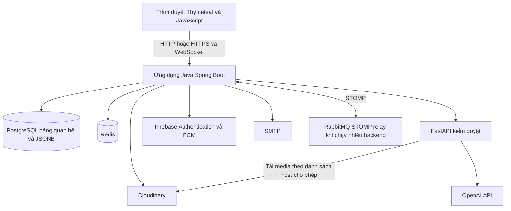

# Hướng dẫn ALOUTE

Ứng dụng mạng xã hội trên nền web, hỗ trợ đăng bài, kết nối người dùng, hội nhóm, nhắn tin và gọi thoại/video. ALOUTE sử dụng Spring Boot cho ứng dụng chính, PostgreSQL để lưu dữ liệu và FastAPI cho dịch vụ kiểm duyệt nội dung bằng AI.

Giao diện được dựng bằng Thymeleaf, CSS và JavaScript ngay trong dự án Java. Không cần chạy một ứng dụng frontend riêng để sử dụng website.

## Mục lục

- [Chức năng](#chức-năng)
- [Công nghệ](#công-nghệ)
- [Kiến trúc và luồng xử lý](#kiến-trúc-và-luồng-xử-lý)
- [Cấu trúc thư mục](#cấu-trúc-thư-mục)
- [Yêu cầu môi trường](#yêu-cầu-môi-trường)
- [Cài đặt và chạy trên máy cá nhân](#cài-đặt-và-chạy-trên-máy-cá-nhân)
- [Cấu hình dịch vụ](#cấu-hình-dịch-vụ)
- [Gọi thoại và video qua LAN hoặc Tailscale](#gọi-thoại-và-video-qua-lan-hoặc-tailscale)
- [Chạy toàn bộ hệ thống bằng Docker Compose](#chạy-toàn-bộ-hệ-thống-bằng-docker-compose)
- [Phân quyền và tài khoản quản trị](#phân-quyền-và-tài-khoản-quản-trị)
- [Giới hạn nội dung và tệp](#giới-hạn-nội-dung-và-tệp)
- [API và kết nối thời gian thực](#api-và-kết-nối-thời-gian-thực)
- [Kiểm thử](#kiểm-thử)
- [Vận hành và xử lý lỗi](#vận-hành-và-xử-lý-lỗi)
- [Tài liệu liên quan](#tài-liệu-liên-quan)
- [Quy trình đóng góp](#quy-trình-đóng-góp)

## Chức năng

| Phân hệ | Chức năng chính |
| --- | --- |
| Tài khoản và xác thực | Đăng ký, xác nhận email bằng OTP, gửi lại mã, đăng nhập, đăng xuất, refresh token, đăng nhập Google qua Firebase, quên và đổi mật khẩu. |
| Hồ sơ người dùng | Xem và sửa hồ sơ, ảnh đại diện, ảnh bìa, giới thiệu, tài khoản công khai/riêng tư, xem bài theo danh sách, lưới media và bài đăng lại. |
| Bài viết và bảng tin | Đăng chữ, ảnh hoặc video; chọn đối tượng xem; bảng tin đề xuất/đang theo dõi; tải thêm; sửa, xóa và xem lịch sử chỉnh sửa. |
| Tương tác và quan hệ xã hội | Theo dõi, duyệt yêu cầu theo dõi, bạn thân, chặn/bỏ chặn, cảm xúc, bình luận, trả lời, chia sẻ, đăng lại và lưu bài. |
| Tìm kiếm | Tìm người dùng và bài viết, tìm theo hashtag; bấm hashtag để mở trang tìm kiếm và chạy truy vấn sẵn; hiển thị mention theo nền sáng/tối. |
| Media và tệp | Tải ảnh/video lên Cloudinary; gửi tệp đính kèm trong chat; ghi nhận chủ sở hữu, mục đích sử dụng và tham chiếu để quản lý vòng đời tệp. |
| Nhắn tin và cuộc gọi | Chat cá nhân/nhóm, lịch sử tin nhắn, tìm tin nhắn, trạng thái đang nhập/gửi/nhận/đã xem, số chưa đọc, gọi thoại/video, lịch sử và thông báo gọi nhỡ. |
| Cộng đồng và hội nhóm | Tạo, khám phá và tham gia cộng đồng; quản lý thành viên, yêu cầu tham gia, bài viết và duyệt nội dung theo quyền trong nhóm. |
| Thông báo | Thông báo trong ứng dụng, đánh dấu đã đọc, số chưa đọc, outbox và cơ chế gửi lại; thông báo đẩy qua Firebase Cloud Messaging khi được cấu hình. |
| Kiểm duyệt và báo cáo | Kiểm duyệt văn bản, ảnh/video; trạng thái chờ xử lý, kết quả kiểm duyệt, thử lại khi lỗi; báo cáo nội dung và thao tác xử lý của quản trị viên. |
| Quản trị | Tra cứu tài khoản, khóa/mở khóa, yêu cầu thoát phiên, lịch sử thao tác; dashboard dành cho HOST. |
| Giao diện | Nền sáng/tối, bố cục thích ứng với màn hình máy tính và điện thoại, điều hướng và cập nhật nội dung bằng JavaScript. |

Quyền xem bài được xác định ở backend theo bốn chế độ `PUBLIC`, `FRIENDS`, `CLOSE_FRIENDS`, `ONLY_ME`. Trong nhiều luồng, bạn bè được xác định từ quan hệ theo dõi hai chiều. Việc lưu bài hoặc biết đường dẫn không thay thế quyền truy cập hiện hành.

## Công nghệ

| Thành phần | Công nghệ trong dự án |
| --- | --- |
| Backend chính | Java 21, Spring Boot 4.1.1, Spring MVC, Validation, Spring Security. |
| Giao diện | Thymeleaf, HTML, CSS, JavaScript; tài nguyên nằm trong `src/main/resources`. |
| Xác thực | JWT, cookie HttpOnly, refresh token, BCrypt; Firebase Authentication cho đăng nhập Google. |
| Dữ liệu | PostgreSQL, Spring Data JPA/JDBC, JSONB, Flyway. |
| Cache và trạng thái tạm | Redis và Caffeine, tùy cấu hình. |
| Thời gian thực | WebSocket, SockJS, STOMP; RabbitMQ STOMP relay khi chạy nhiều backend. |
| Cuộc gọi | WebRTC, STUN/TURN; Coturn trong Docker Compose. |
| Lưu media | Cloudinary. |
| Email và push | SMTP, Firebase Cloud Messaging. |
| Kiểm duyệt AI | Python, FastAPI, Uvicorn, HTTPX, Pillow, FFmpeg/FFprobe, API OpenAI. |
| Kiểm thử | JUnit, Mockito, Spring Boot Test, ArchUnit, Maven Failsafe, JaCoCo, pytest; các kịch bản Node.js/Playwright và k6. |
| Đóng gói và triển khai | Maven Wrapper, Docker Compose, Nginx, GitHub Actions. |

PostgreSQL là cơ sở dữ liệu chính của ứng dụng. Các đối tượng trong `model/document` được lưu bằng JSONB qua `PostgresDocumentStore`, không yêu cầu cài MongoDB.

## Kiến trúc và luồng xử lý



Backend chính được tổ chức theo các phân hệ nghiệp vụ, đồng thời còn các lớp tương thích trong `controller`, `service`, `repository` và `model`. FastAPI là dịch vụ riêng phục vụ kiểm duyệt; không phải mỗi chức năng của ALOUTE là một microservice.

Các luồng chính:

1. **Yêu cầu web:** trình duyệt gọi controller; backend xác thực, kiểm tra quyền, thực hiện nghiệp vụ và đọc/ghi PostgreSQL trước khi trả HTML hoặc JSON.
2. **Đăng bài:** tải media nếu có, ghi nhận quyền sở hữu, tạo bài và chuyển qua luồng kiểm duyệt nền. Worker lưu kết quả hoặc lịch thử lại; bảng tin áp dụng trạng thái kiểm duyệt và quyền xem.
3. **Gửi tin:** client gửi STOMP với `clientId`; backend kiểm tra người gửi, quyền trò chuyện và chống ghi trùng, sau đó lưu và phát tin cho đúng người nhận.
4. **Gọi điện:** offer, answer, ICE và hangup đi qua backend bằng STOMP. Âm thanh/video truyền bằng WebRTC giữa hai trình duyệt hoặc qua TURN khi cần, không truyền xuyên qua controller chat.
5. **Thông báo:** thông báo hoặc ý định gửi được lưu, worker gửi và thử lại theo trạng thái outbox. Không coi việc đã phát WebSocket là người nhận đã đọc.

Khi dùng một backend local, hệ thống có thể sử dụng broker trong bộ nhớ. Khi dùng nhiều backend, cần broker và trạng thái dùng chung để tin nhắn, cuộc gọi không bị chia cắt giữa các máy.

## Cấu trúc thư mục

```text
.
├── src/main/java/com/aloute/
│   ├── AlouteApplication.java       # Điểm khởi động
│   ├── config/                      # Bảo mật, dịch vụ local, cache, WebSocket
│   ├── controller/                  # Trang HTML, REST API và STOMP
│   ├── service/                     # Nghiệp vụ và lớp tích hợp hiện có
│   ├── identity/ users/ social/      # Tài khoản, người dùng và quan hệ
│   ├── posts/ feed/ communities/     # Bài viết, bảng tin và cộng đồng
│   ├── messaging/ notifications/     # Chat, cuộc gọi và thông báo
│   ├── media/ moderation/            # Media và chính sách kiểm duyệt
│   ├── administration/              # Quản trị
│   ├── model/ dto/ repository/       # Mô hình, dữ liệu trao đổi và truy cập dữ liệu
│   └── persistence/                 # Lưu trữ PostgreSQL, gồm document JSONB
├── src/main/resources/
│   ├── application*.yml             # Cấu hình và các profile
│   ├── db/migration/                # Migration Flyway
│   ├── templates/                   # Giao diện Thymeleaf
│   ├── static/                      # JavaScript, CSS, ảnh và thư viện trình duyệt
│   └── local-services/              # Redis/moderation đóng gói kèm JAR
├── src/test/java/                   # Kiểm thử Java và kiểm thử tích hợp
├── src/test/browser/                # Kịch bản Node.js và Playwright
├── moderation/                      # FastAPI, Dockerfile và kiểm thử Python
├── deploy/                          # Nginx, backup, helper WSL, kiểm tra schema, k6
├── docs/architecture/               # Tài liệu kiến trúc và ranh giới phân hệ
├── docs/quality/                    # Ghi nhận kiểm tra và thay đổi theo từng đợt
├── .github/workflows/ci.yml         # Quy trình CI
├── .env.example                    # Mẫu cấu hình, không chứa khóa thật
├── docker-compose.yml              # App, Nginx, Redis, moderation, RabbitMQ, TURN
├── docker-compose.dev.yml          # Mailpit và các dịch vụ phát triển tùy chọn
├── setup-lan-call.ps1               # Tạo HTTPS và chạy thử gọi qua LAN/Tailscale
├── pom.xml                         # Dependency và cấu hình build Java
└── mvnw / mvnw.cmd                  # Maven Wrapper cho Linux/macOS và Windows
```

## Yêu cầu môi trường

| Công cụ hoặc dịch vụ | Khi nào cần |
| --- | --- |
| JDK 21 | Build/chạy từ mã nguồn. CI và image Java của dự án dùng Java 21. |
| Git | Lấy mã nguồn và quản lý thay đổi. |
| PostgreSQL | Bắt buộc; CI dùng PostgreSQL 17. Database phải được tạo trước khi chạy ứng dụng. |
| Docker có Compose | Chạy hệ thống bằng container hoặc để backend tự bật Redis/moderation local. |
| Cloudinary | Tải và lưu ảnh, video, tệp. |
| SMTP hoặc Mailpit local | Nhận OTP xác nhận email và khôi phục mật khẩu. |
| OpenAI API và token moderation nội bộ | Chạy dịch vụ kiểm duyệt thực tế. |
| Firebase | Đăng nhập Google và thông báo đẩy; cấu hình theo chức năng sử dụng. |
| Python và FFmpeg | Chỉ cần cài riêng nếu chạy/kiểm thử moderation ngoài container. Image moderation dùng Python 3.12. |
| Node.js, Playwright, k6 | Tùy chọn cho kiểm thử giao diện và tải; không cần để build frontend khi chạy website. |

Maven Wrapper tải bản Maven được khai báo trong `.mvn/wrapper/maven-wrapper.properties`. Lần build đầu và lần dựng container đầu cần kết nối Internet.

## Cài đặt và chạy trên máy cá nhân

Các lệnh dưới đây thực hiện từ thư mục gốc repository. Ví dụ chạy trực tiếp dùng cổng **8085**, được đặt rõ bằng `SERVER_PORT`; Docker Compose dùng **8085**. Khi chạy môi trường khác, lấy cổng thực tế từ cấu hình và log khởi động.

### 1. Lấy mã nguồn

```powershell
git clone https://github.com/bithichanpho/aloute.git
cd aloute
java -version
.\mvnw.cmd -version
```

Trên Linux/macOS, dùng `./mvnw` thay cho `.\mvnw.cmd`. Nếu wrapper chưa có quyền chạy, dùng `chmod +x mvnw`.

### 2. Chuẩn bị cấu hình

Tạo `.env` từ mẫu nếu chưa có:

```powershell
if (-not (Test-Path -LiteralPath .env)) {
    Copy-Item -LiteralPath .env.example -Destination .env
}
```

Ứng dụng Java đọc `.env` bằng Spring Config Import khi được chạy từ thư mục chứa file này. Không cần mở `.env` rồi thực thi nó như script. Biến môi trường của tiến trình và tham số dòng lệnh có thể ghi đè giá trị trong file.

Điền thông tin dịch vụ của mình vào `.env`. Với **một backend chạy trực tiếp trên máy**, chỉnh các giá trị sau bên cạnh khóa Cloudinary, SMTP, Firebase và OpenAI:

```dotenv
DB_URL=jdbc:postgresql://localhost:5432/aloute
DB_USERNAME=postgres
DB_PASSWORD=THAY_BANG_MAT_KHAU_POSTGRES_CUA_BAN
DB_SCHEMA=public
DB_DDL_AUTO=validate

SERVER_PORT=8085
FRONTEND_BASE_URL=http://localhost:8085
APP_CORS_ALLOWED_ORIGINS=http://localhost:8085
APP_SECURITY_COOKIE_SECURE=false

REDIS_URL=redis://localhost:6379
REDIS_CACHE_ENABLED=true
RATE_LIMIT_REDIS_REQUIRED=false
LOCAL_SERVICES_AUTO_START=true

MODERATION_ENABLED=true
MODERATION_SERVICE_URL=http://localhost:8000

APP_WEBSOCKET_BROKER_RELAY_ENABLED=false
APP_CALLS_DISTRIBUTED_STATE_ENABLED=false
APP_WEBRTC_TURN_URLS=
APP_WEBRTC_TURN_SHARED_SECRET=

APP_HOST_BOOTSTRAP_ENABLED=false
```

**Chọn đúng môi trường:** `.env.example` mặc định dành cho một backend local, với relay/distributed tắt và URL TURN trống. Nếu dùng `.env` cũ, đối chiếu hai cờ này trước khi chạy trực tiếp để tránh tìm RabbitMQ hoặc TURN chưa được triển khai. Khi chạy stack Docker, Compose ghi đè hai cờ thành `true` và dùng broker nội bộ.

Thay các giá trị `CHANGE_ME` trong mẫu bằng cấu hình thật của môi trường. `JWT_SECRET`, `APP_SECURITY_ENCRYPTION_KEY`, `MODERATION_API_TOKEN` phải là các khóa riêng biệt; các khóa này dùng giá trị ngẫu nhiên ít nhất 32 byte theo yêu cầu của cấu hình tương ứng. `OPENAI_API_KEY` phải là khóa do nhà cung cấp cấp, không thay bằng chuỗi ngẫu nhiên.

Không đưa `.env`, JSON Firebase Admin, chứng chỉ riêng hoặc mật khẩu vào Git.

### 3. Tạo database PostgreSQL

Nếu dùng PostgreSQL đã cài trên máy và database `aloute` chưa tồn tại:

```powershell
psql -h localhost -U postgres -d postgres -c "CREATE DATABASE aloute;"
```

Cập nhật `DB_URL`, tài khoản và mật khẩu tương ứng. Nếu dùng PostgreSQL trên máy khác hoặc dịch vụ được quản lý, sử dụng JDBC URL và tham số SSL mà môi trường đó cung cấp.

Khi khởi động, Flyway áp dụng migration trong `src/main/resources/db/migration`; Hibernate kiểm tra ánh xạ với `ddl-auto=validate`. Tài khoản chạy migration cần đủ quyền tạo/cập nhật đối tượng trong schema, bao gồm extension `pg_trgm` mà migration tìm kiếm sử dụng.

Với database đã có dữ liệu, sao lưu và đối chiếu lịch sử Flyway trước khi nâng cấp. Không đổi sang `create-drop`, xóa lịch sử migration hoặc sửa checksum để bỏ qua lỗi trên database đang sử dụng.

### 4. Khởi động Redis và moderation

Mở Docker, điền cấu hình kiểm duyệt rồi chạy backend ở bước tiếp theo. Theo cấu hình mặc định, backend kiểm tra và tự bật dịch vụ còn thiếu:

- Redis local tại `localhost:6379`, không có xác thực.
- FastAPI moderation local tại `http://localhost:8000`.

Dịch vụ đã sẵn sàng được dùng lại; dừng backend không dừng hai dịch vụ này. Lần dựng đầu có thể mất vài phút; `LOCAL_SERVICES_STARTUP_TIMEOUT` mặc định là `5m`. Cơ chế này không tự tạo PostgreSQL.

Nếu muốn tự chạy moderation từ repository:

```powershell
docker compose --env-file .env -f moderation/docker-compose.standalone.yml up -d --build
```

Đặt `LOCAL_SERVICES_AUTO_START=false` nếu tự quản lý toàn bộ dịch vụ. Cờ này chỉ tắt việc tự khởi động, không thay thế Redis hay moderation mà chức năng đang cần.

Trên Windows đã cài Ubuntu WSL, có thể dùng helper thay cho Docker:

```powershell
.\deploy\start-local-moderation.ps1 -InstallDependencies
.\deploy\start-local-redis.ps1
```

Helper Redis yêu cầu `redis-server` đã được cài trong Ubuntu WSL. Những lần chạy moderation tiếp theo có thể bỏ `-InstallDependencies`. Hướng dẫn và vị trí log chi tiết nằm trong [moderation/README_LOCAL_VI.md](../moderation/README_LOCAL_VI.md).

### 5. Chạy ứng dụng

Windows PowerShell:

```powershell
$env:SERVER_PORT = '8085'
.\mvnw.cmd spring-boot:run
```

Linux/macOS:

```bash
SERVER_PORT=8085 ./mvnw spring-boot:run
```

Hoặc mở dự án Maven trong IDE, chọn JDK 21 và chạy `com.aloute.AlouteApplication` với thư mục làm việc là gốc repository.

Sau khi thấy log `Started AlouteApplication`, mở [http://localhost:8085](http://localhost:8085). Kiểm tra nhanh:

```powershell
Invoke-RestMethod http://localhost:8085/actuator/health
Invoke-RestMethod http://localhost:8000/healthz
```

Đăng ký tài khoản, lấy OTP qua email rồi đăng nhập để sử dụng các chức năng. Không có tài khoản quản trị mặc định được tạo khi chạy cấu hình thông thường.

### 6. Đóng gói và chạy JAR

```powershell
.\mvnw.cmd clean package
java -jar target/aloute-0.0.1-SNAPSHOT.jar --server.port=8085
```

Chạy lệnh build với cấu hình kiểm thử riêng; xem [Kiểm thử](#kiểm-thử). Khi mang JAR sang máy khác, đặt `.env` cạnh JAR và chạy từ thư mục đó. PostgreSQL cùng các thông tin dịch vụ vẫn cần được chuẩn bị. Redis/moderation local được đóng gói kèm tài nguyên để dựng qua Docker, không yêu cầu đường dẫn máy lập trình viên.

## Cấu hình dịch vụ

### Các nhóm biến môi trường

Danh sách đầy đủ các biến mẫu nằm trong [.env.example](../.env.example); các giá trị mặc định và profile nằm trong `src/main/resources/application*.yml`.

| Nhóm | Biến chính | Ý nghĩa |
| --- | --- | --- |
| PostgreSQL | `DB_URL`, `DB_USERNAME`, `DB_PASSWORD`, `DB_SCHEMA`, `DB_DDL_AUTO` | Kết nối, schema và chế độ kiểm tra ánh xạ. |
| Kết nối Docker tới DB | `COMPOSE_DB_URL` | JDBC URL nhìn từ container; không dùng `localhost` để trỏ về PostgreSQL trên máy host. |
| Pool DB | `DB_POOL_MAX`, `DB_POOL_MIN` | Giới hạn kết nối mỗi backend; cần tính tổng khi tăng số bản sao. |
| JWT và phiên | `JWT_SECRET`, `JWT_EXPIRATION`, `APP_REFRESH_TOKEN_DAYS` | Khóa ký, hạn access token theo mili giây và hạn refresh token theo ngày. |
| Bảo mật | `APP_SECURITY_ENCRYPTION_KEY`, `APP_SECURITY_COOKIE_SECURE`, `APP_TRUSTED_PROXY_CIDRS` | Khóa mã hóa, cookie HTTPS và danh sách proxy được tin cậy. |
| Địa chỉ web | `SERVER_PORT`, `FRONTEND_BASE_URL`, `APP_CORS_ALLOWED_ORIGINS` | Cổng chạy, liên kết gửi qua email và origin được phép truy cập. |
| Cloudinary | `CLOUDINARY_CLOUD_NAME`, `CLOUDINARY_API_KEY`, `CLOUDINARY_API_SECRET` | Tải và quản lý media/tệp. |
| SMTP | `MAIL_HOST`, `MAIL_PORT`, `MAIL_USERNAME`, `MAIL_PASSWORD`, `MAIL_FROM` | Email OTP và khôi phục tài khoản. |
| Firebase | `FIREBASE_PROJECT_ID`, `FIREBASE_WEB_*`, `FIREBASE_MESSAGING_SENDER_ID`, `FIREBASE_STORAGE_BUCKET`, `FIREBASE_VAPID_KEY`, `FIREBASE_ADMIN_CREDENTIALS` | Google login, cấu hình Web SDK, FCM và thông tin xác thực server. |
| Kiểm duyệt | `MODERATION_ENABLED`, `MODERATION_SERVICE_URL`, `MODERATION_API_TOKEN`, `OPENAI_API_KEY`, `MODERATION_ALLOWED_MEDIA_HOSTS` | Bật kiểm duyệt, địa chỉ nội bộ, token chung giữa Java/Python, khóa upstream và host được tải media. |
| Timeout và retry | `MODERATION_TEXT_TIMEOUT`, `MODERATION_UPLOAD_MEDIA_TIMEOUT`, `MODERATION_MAX_ATTEMPTS`, `MODERATION_LEASE_SECONDS` | Thời gian chờ và xử lý lại công việc kiểm duyệt. |
| Redis | `REDIS_URL`, `REDIS_CACHE_ENABLED`, `RATE_LIMIT_REDIS_REQUIRED` | Cache và giới hạn tần suất dùng chung. |
| Dịch vụ local | `LOCAL_SERVICES_AUTO_START`, `LOCAL_SERVICES_STARTUP_TIMEOUT` | Tự bật Redis/moderation và thời gian chờ khởi động. |
| WebSocket | `APP_WEBSOCKET_BROKER_RELAY_ENABLED`, `APP_WEBSOCKET_BROKER_RELAY_HOST`, `APP_WEBSOCKET_BROKER_RELAY_PORT`, `RABBITMQ_USER`, `RABBITMQ_PASSWORD` | Kết nối STOMP relay khi dùng nhiều backend. |
| WebRTC | `APP_WEBRTC_STUN_URLS`, `APP_WEBRTC_TURN_URLS`, `APP_WEBRTC_TURN_SHARED_SECRET` | ICE server và khóa tạo thông tin đăng nhập TURN có thời hạn. |
| Triển khai TURN | `TURN_PUBLIC_HOST`, `TURN_EXTERNAL_IP`, `TURN_REALM`, `TURN_SHARED_SECRET` | Địa chỉ và xác thực Coturn trong Compose. |
| Upload | `ALOUTE_MAX_UPLOAD_SIZE`, `ALOUTE_MAX_UPLOAD_REQUEST_SIZE` | Trần multipart; không thay thế giới hạn riêng của từng endpoint. |
| Quản trị | `APP_HOST_USERNAME`, `APP_HOST_BOOTSTRAP_ENABLED` | Nâng một tài khoản đã xác minh thành HOST khi chủ động bật. |
| API docs | `OPENAPI_ENABLED` | Bật/tắt OpenAPI và Swagger UI; mặc định tắt. |

### Các profile

| Profile | Mục đích |
| --- | --- |
| Không chỉ định profile | Phát triển local; cấu hình từ `.env`, các file import và biến môi trường. |
| `no-redis` | Tắt cache Redis và yêu cầu Redis cho rate limit. Vẫn cần PostgreSQL và moderation nếu bật kiểm duyệt. |
| `demo` | Trình diễn local có chủ đích: tắt kiểm duyệt từ xa, cache Redis và cookie secure. Không dùng để đánh giá luồng kiểm duyệt hoặc triển khai công khai. |
| `lan-call` | Một backend HTTPS cho nhiều thiết bị cùng truy cập; tắt relay và trạng thái cuộc gọi phân tán. |
| `call-distributed` | Nhiều backend dùng chung PostgreSQL, Redis, RabbitMQ và TURN; cần cấu hình đầy đủ hạ tầng. |
| `prod` | Triển khai: kiểm duyệt bật, cookie secure mặc định bật, yêu cầu cấu hình bảo mật và hạ tầng dùng chung. |

Ví dụ chạy không dùng Redis:

```powershell
.\mvnw.cmd spring-boot:run "-Dspring-boot.run.profiles=no-redis"
```

`no-redis` không tự tắt hai cờ broker relay/distributed trong `.env`; dùng cấu hình một backend ở phần cài đặt nếu không có RabbitMQ. Tự bật local services không áp dụng cho các profile `prod`, `production`, `call-distributed`, `test`, hoặc khi đã để Spring Boot quản lý Docker Compose.

### Email local với Mailpit

Mailpit dùng để nhận email thử nghiệm ngay trên máy:

```powershell
docker compose -f docker-compose.dev.yml up -d mailpit
```

Đặt `MAIL_HOST=localhost`, `MAIL_PORT=1025`, `MAIL_FROM=ALOUTE <no-reply@localhost>` trong `.env`. Chạy Java với SMTP auth và STARTTLS tắt cho Mailpit:

```powershell
.\mvnw.cmd spring-boot:run "-Dspring-boot.run.arguments=--spring.mail.properties.mail.smtp.auth=false --spring.mail.properties.mail.smtp.starttls.enable=false"
```

Mở [http://localhost:8025](http://localhost:8025) để lấy OTP. Hai tùy chọn tắt auth/TLS ở trên chỉ dành cho Mailpit local; giữ cấu hình tương ứng nhà cung cấp khi dùng SMTP thật.

### Firebase

1. Tạo project và ứng dụng Web trong Firebase, bật nhà cung cấp Google cho Authentication.
2. Điền các giá trị Web SDK trong `.env.example`, cùng domain được phép đăng nhập tương ứng môi trường chạy.
3. Cấu hình server bằng `FIREBASE_PROJECT_ID` và `FIREBASE_ADMIN_CREDENTIALS` trỏ đến JSON service account trên máy. Backend cũng hỗ trợ Application Default Credentials khi không đặt đường dẫn riêng.
4. Với push trên trình duyệt, điền `FIREBASE_VAPID_KEY`, dùng origin phù hợp và cho phép nhận thông báo.

JSON Firebase Admin chỉ nằm ở phía server. Không đặt file này trong `static`, không gửi xuống trình duyệt. Nếu Firebase Admin chưa khởi tạo được, cần xử lý cấu hình để dùng Google login/FCM; việc website mở được không chứng minh hai tích hợp này đang hoạt động.

## Gọi thoại và video qua LAN hoặc Tailscale

Mic/camera trên địa chỉ LAN hoặc Tailscale cần một origin HTTPS được trình duyệt tin cậy. Chỉ đổi `http` thành `https` trên thanh địa chỉ khi backend chưa bật TLS sẽ gây lỗi giao thức.

Với một backend chạy Windows, helper tạo chứng chỉ và chạy profile `lan-call`:

```powershell
.\setup-lan-call.ps1 -LanIp 100.117.88.61 -Port 8085 -TrustCertificate
```

`100.117.88.61` là ví dụ địa chỉ Tailscale của máy chạy backend; thay bằng IPv4 thực sự được gán cho máy của mình. Helper kiểm tra địa chỉ trước khi tạo cấu hình.

1. Dừng backend đang chiếm cổng 8085 trước khi chạy helper.
2. Kết nối các thiết bị vào cùng mạng LAN hoặc tailnet có quyền truy cập máy chủ.
3. Chạy helper bằng Windows PowerShell. `-TrustCertificate` cài CA phát triển do helper tạo vào kho tin cậy của tài khoản Windows đang chạy.
4. Trên máy khách, cài và tin cậy **chứng chỉ công khai** `dev-certs/aloute-lan-ca.cer` do chính máy chủ tạo. Giữ riêng `.p12` và `keystore-password.txt` trên máy chủ.
5. Cho phép kết nối TCP vào cổng đã chọn trong tường lửa nếu cần; helper không tự sửa tường lửa.
6. Cả hai thiết bị mở cùng địa chỉ, ví dụ `https://100.117.88.61:8085`, đăng nhập bằng hai tài khoản và cấp quyền mic/camera.

Helper đặt origin, URL frontend và cookie theo HTTPS trong tiến trình chạy đó. Có thể dùng `-PrepareOnly` để chỉ chuẩn bị chứng chỉ. Khi IP thay đổi, dùng `-ForceNewCertificate` rồi cập nhật CA tin cậy trên các thiết bị.

Tailscale cung cấp kết nối mạng; HTTPS cung cấp origin tin cậy. Kết nối báo hiệu thành công vẫn chưa đảm bảo âm thanh/video đi được qua mọi NAT hoặc tường lửa. Nếu cần TURN, cấu hình server TURN có thể truy cập từ cả hai máy và đặt URL/khóa tương ứng.

Nếu chạy **hai backend riêng**, sử dụng `call-distributed` và cùng PostgreSQL, Redis, RabbitMQ STOMP broker, TURN, khóa JWT cùng cấu hình bảo mật thống nhất. Không dùng broker trong bộ nhớ riêng trên từng máy cho trường hợp này.

## Chạy toàn bộ hệ thống bằng Docker Compose

`docker-compose.yml` gồm `app`, `nginx`, `redis`, `moderation`, `rabbitmq`, `turn`. **Không có PostgreSQL trong file này**; cần chuẩn bị database bên ngoài trước.

### Chuẩn bị

- Điền `.env` từ mẫu với các mật khẩu/khóa riêng cho môi trường triển khai.
- Đặt `COMPOSE_DB_URL` đến địa chỉ PostgreSQL mà container truy cập được. Với DB trên máy host, mẫu dùng `host.docker.internal`.
- Đặt `FIREBASE_ADMIN_CREDENTIALS` đến file JSON có thật trên host. Compose mount file này chỉ đọc vào `/run/secrets/firebase-admin.json` trong container.
- Điền `REDIS_PASSWORD`, `RABBITMQ_PASSWORD`, `TURN_SHARED_SECRET`, token moderation và khóa OpenAI; không dùng các giá trị `CHANGE_ME`.
- Cấu hình `TURN_PUBLIC_HOST`, `TURN_EXTERNAL_IP`, `APP_WEBRTC_TURN_URLS` theo địa chỉ máy khách truy cập được. Giá trị `localhost` chỉ dùng cho trường hợp truy cập từ chính máy đó.
- Đặt `FRONTEND_BASE_URL`, `APP_CORS_ALLOWED_ORIGINS` theo URL thực tế và `APP_SECURITY_COOKIE_SECURE=true` khi dùng HTTPS.
- Đặt `APP_TRUSTED_PROXY_CIDRS` theo proxy trực tiếp; kiểm tra subnet `172.29.0.0/24` trong Compose không xung đột với mạng đang sử dụng.

Khởi động từ thư mục gốc:

```powershell
docker compose --env-file .env config --quiet
docker compose --env-file .env up -d --build
docker compose ps
docker compose logs --tail=100 app moderation nginx
```

Compose chạy profile `prod`, đặt cổng nội bộ app là `8080` và mặc định khai báo hai bản sao bằng `APP_REPLICAS=2`. Nginx nhận truy cập từ máy host ở cổng `8085`. Redis và RabbitMQ không mở cổng ra host. Moderation chỉ publish ở loopback `127.0.0.1:8000`.

Nginx của Compose publish **HTTP tại `127.0.0.1:8085`**. Cấu hình này chưa cấp TLS công khai. Khi triển khai cho người dùng, cần đặt reverse proxy HTTPS phù hợp phía trước, chuyển tiếp WebSocket và dùng chứng chỉ hợp lệ. Các mẫu proxy nằm trong `deploy/nginx/`; thay domain, chứng chỉ và địa chỉ upstream theo môi trường.

Để kiểm tra riêng trên máy qua `http://localhost:8085`, cookie secure phải phù hợp với HTTP và origin phải trỏ về cổng 8085. Không giữ cấu hình HTTP local đó khi đưa ra Internet hoặc đánh giá cuộc gọi qua IP từ thiết bị khác.

Coturn mở TCP/UDP `3478` và UDP `49160-49200`; cần cấu hình NAT/tường lửa và địa chỉ công bố phù hợp. Tổng kết nối DB tăng theo số bản sao, vì vậy kiểm tra `APP_REPLICAS × DB_POOL_MAX` cùng các tiến trình khác so với giới hạn PostgreSQL.

Theo dõi và dừng:

```powershell
docker compose logs -f app moderation
docker compose down
```

`down` dừng stack Compose; không xóa database PostgreSQL bên ngoài. Volume Redis được giữ lại khi không yêu cầu xóa volume.

## Phân quyền và tài khoản quản trị

| Vai trò | Quyền chính |
| --- | --- |
| `ROLE_USER` | Sử dụng mạng xã hội, chat, cuộc gọi và hội nhóm trong phạm vi quyền sở hữu/thành viên. |
| `ROLE_ADMIN` | Quản trị tài khoản và nội dung theo các endpoint được cấp. |
| `ROLE_HOST` | Quyền quản trị hệ thống, dashboard HOST, các endpoint vận hành và quyền quản trị tương ứng. |

Quản lý một hội nhóm không đồng nghĩa có quyền ADMIN/HOST toàn hệ thống. Backend kiểm tra quyền theo từng API; ẩn nút trên giao diện không phải biện pháp phân quyền duy nhất.

Để cấp HOST bằng cơ chế có sẵn:

1. Đăng ký tài khoản cần dùng và xác nhận email. Tài khoản phải đang hoạt động.
2. Đặt `APP_HOST_USERNAME` bằng username đó và `APP_HOST_BOOTSTRAP_ENABLED=true` trong môi trường quản lý.
3. Khởi động lại, kiểm tra log nâng quyền thành công.
4. Đặt lại `APP_HOST_BOOTSTRAP_ENABLED=false` sau khi hoàn tất, rồi đăng nhập lại để sử dụng quyền mới.

Seeder demo quản trị chỉ chạy khi chủ động bật `APP_SEED_DEMO_ADMIN`; không dùng trên môi trường công khai vì nó đặt lại thông tin tài khoản demo có sẵn trong code mỗi lần chạy. Cấu hình thông thường không bật seeder này. API thiết lập 2FA cũ đã được loại khỏi controller tài khoản hiện hành; không coi các khóa cấu hình mã hóa còn lại là bằng chứng có tính năng 2FA trên giao diện.

## Giới hạn nội dung và tệp

| Nội dung hoặc endpoint | Giới hạn hiện hành |
| --- | --- |
| Nội dung bài viết | Tối đa 2.000 ký tự; bài cần có chữ hoặc media hợp lệ. |
| Ảnh qua `/api/upload/image` | 15 MB mỗi ảnh. |
| Tệp đính kèm chat qua `/api/upload/file` | 1 MB = 1.048.576 byte mỗi tệp; không chấp nhận tệp rỗng. |
| Media qua `/api/upload/media` | Mặc định 50 MB theo `app.upload.max-file-size`/`ALOUTE_MAX_UPLOAD_SIZE`, gồm luồng ảnh/video chat. |
| Multipart của Spring | Mặc định 50 MB mỗi tệp, 52 MB mỗi request. |
| Video tại dịch vụ kiểm duyệt | Tối đa 50 MB và 180 giây theo hằng số trong `moderation/main.py`; còn phụ thuộc kiểm tra định dạng, khả năng giải mã và timeout. |

Các trần được áp dụng đồng thời: tăng giới hạn multipart không làm giới hạn file chat 1 MB hoặc endpoint ảnh 15 MB tự tăng. File `1,2 KB` nhỏ hơn 1 MB nên vẫn gửi được.

Luồng tệp chat `/api/upload/file` nhận nhiều loại tệp và không quét nội dung. Backend vẫn kiểm tra đăng nhập, tần suất, dung lượng và quyền sở hữu khi sử dụng tệp. Luồng ảnh/video kiểm tra định dạng riêng; media chat phải qua kiểm duyệt trước khi trả URL dùng để gửi, còn media bài viết đi theo quy trình worker sau khi tạo bài.

Media được đăng ký theo người tải và `purpose`, ví dụ `post`, `chat`, `avatar`, `community`. Không được lấy URL của người khác để gắn vào nội dung của mình. Dọn dữ liệu còn tham chiếu và xóa tệp vật lý là hai việc khác nhau; chính sách xóa vật lý media hiện mặc định chưa bật.

## API và kết nối thời gian thực

### Các trang chính

| Đường dẫn | Nội dung |
| --- | --- |
| `/login`, `/register`, `/verify-email` | Đăng nhập, đăng ký và xác nhận email. |
| `/forgot-password`, `/verify-reset-code`, `/reset-password` | Luồng khôi phục mật khẩu. |
| `/feed`, `/compose`, `/search` | Bảng tin, tạo bài và tìm kiếm. |
| `/people/{username}`, `/profile/me`, `/profile/edit` | Hồ sơ người dùng. |
| `/chat`, `/activity`, `/follow-requests`, `/saved` | Nhắn tin, thông báo, yêu cầu theo dõi và bài đã lưu. |
| `/communities`, `/communities/{communityId}` | Danh sách và chi tiết cộng đồng. |
| `/settings` | Cài đặt tài khoản. |
| `/admin/accounts`, `/admin/moderation` | Quản trị tài khoản và nội dung theo quyền. |
| `/host/server` | Dashboard HOST. |

### Nhóm API

| Tiền tố hoặc endpoint | Phạm vi |
| --- | --- |
| `/api/auth/**` | Đăng ký, OTP, đăng nhập, refresh, đăng xuất và khôi phục tài khoản. |
| `/api/users/**`, `/api/close-friends/**`, `/api/blocks/**` | Hồ sơ và quan hệ người dùng. |
| `/api/posts/**`, `/api/comments/**`, `/api/saved` | Bài viết, tương tác, lịch sử và lưu bài. |
| `/api/search/**` | Tìm kiếm và gợi ý. |
| `/api/upload/image`, `/api/upload/media`, `/api/upload/file` | Tải tệp; request multipart dùng trường `file`. |
| `/api/chat/**` | Cuộc trò chuyện, tin nhắn, đọc tin và nhóm chat. |
| `/api/communities/**` | Cộng đồng và duyệt nội dung nhóm. |
| `/api/notifications/**`, `/api/push/**` | Thông báo và đăng ký push. |
| `/api/webrtc/ice-servers` | Cấu hình ICE cho tài khoản đã đăng nhập. |
| `/api/admin/**`, `/api/host/**` | API quản trị theo vai trò. |

Các API thông thường dùng cấu trúc phản hồi `success`, `message`, `data`. Cookie access token có tên `ALOUTE_TOKEN`, được cấp qua luồng đăng nhập; client cần giữ và gửi cookie theo đúng origin. Một số API hỗ trợ phân trang bằng cursor: dùng cursor server trả về, không tự dựng từ ID hiển thị.

Bật `OPENAPI_ENABLED=true`, đăng nhập tài khoản ADMIN/HOST rồi mở `/swagger-ui/index.html` hoặc `/v3/api-docs` để xem hợp đồng API được sinh từ controller. Bật cờ này không bỏ qua kiểm tra quyền.

### WebSocket và STOMP

- Endpoint kết nối SockJS: `/ws`.
- Tiền tố gửi từ client: `/app`; tiền tố đích riêng người dùng: `/user`.
- Gửi tin: `/app/chat.send`; báo nhận: `/app/chat.delivered`; đang nhập: `/app/chat.typing`.
- Báo hiệu gọi: `/app/call.offer`, `/app/call.answer`, `/app/call.ice`, `/app/call.hangup`.
- Các queue nhận điển hình: `/user/queue/messages`, `/user/queue/typing`, `/user/queue/call`, `/user/queue/errors`.

Kết nối cần được xác thực; việc endpoint handshake được truy cập không có nghĩa người chưa đăng nhập được đọc/gửi tin. Giữ `clientId` khi thử gửi lại cùng một tin để backend nhận diện bản gửi trùng.

### Health và quan sát hệ thống

- Backend: `/actuator/health`, cùng liveness/readiness probe dưới `/actuator/health/**`.
- FastAPI: `/healthz` trên cổng moderation, không phải cổng website.
- Metrics: `/actuator/metrics`, `/actuator/prometheus`; các endpoint Actuator ngoài health yêu cầu HOST.
- Log có `requestId`, `traceId`, `spanId` để hỗ trợ đối chiếu yêu cầu.

`/healthz` trả `ok` xác nhận dịch vụ moderation sẵn sàng ở mức kiểm tra local; không chứng minh khóa, quota OpenAI hoặc đường tải Cloudinary hoạt động cho mọi yêu cầu thực tế.

## Kiểm thử

Dùng database và tài khoản **riêng cho kiểm thử**. Một số kiểm thử tích hợp tạo/xóa dữ liệu hoặc schema; không trỏ biến cấu hình kiểm thử đến database đang phục vụ người dùng.

### Java và coverage

```powershell
# Kiểm thử được Maven Surefire chọn, chủ yếu các lớp *Test
.\mvnw.cmd test

# Build, kiểm thử tích hợp được Failsafe chọn và xuất coverage
.\mvnw.cmd -Pcoverage clean verify

# Ví dụ chỉ chạy nhóm kiểm tra upload
.\mvnw.cmd "-Dtest=UploadControllerTest,UploadPurposeTest,UploadContentValidatorTest,MediaAssetLifecycleServiceTest" test
```

Trên Linux/macOS dùng `./mvnw`. Báo cáo nằm trong `target/surefire-reports`, `target/failsafe-reports` và `target/site/jacoco/index.html` khi dùng profile coverage.

Một số kiểm thử chỉ chạy khi có biến môi trường, database hoặc cờ bật tương ứng. Ví dụ `AlouteApplicationTests` phụ thuộc `DB_URL`; các bài kiểm tra schema dùng `ALOUTE_SCHEMA_VALIDATION_*`. Kết quả có bài bị bỏ qua không chứng minh các tích hợp đó đã được xác minh.

Kiểm tra Flyway và Hibernate trên PostgreSQL rỗng bằng container tạm:

```powershell
.\deploy\scripts\validate-empty-schema.ps1
```

Script dùng Docker, tạo PostgreSQL thử ở cổng `55439`, chạy `FreshPostgresSchemaValidationIT` và dọn container khi xong.

### Kiểm thử moderation

Trong môi trường Python riêng, từ thư mục gốc:

```powershell
python -m venv .venv
.\.venv\Scripts\python.exe -m pip install -r moderation/requirements-dev.txt
.\.venv\Scripts\python.exe -m pytest moderation/tests
```

Linux/macOS dùng `.venv/bin/python` thay cho `.\.venv\Scripts\python.exe`. Các bài kiểm tra xử lý video local cần `ffmpeg` và `ffprobe`; xem kết quả skipped nếu thiếu công cụ. Các bài dùng provider giả không thay thế việc kiểm tra API thực tế.

Khi muốn kiểm tra tích hợp thật với dịch vụ đang chạy, helper sau gọi API OpenAI thông qua moderation và có thể phát sinh chi phí upstream:

```powershell
.\deploy\test-moderation.ps1
```

### Kiểm thử giao diện và tải

Các kịch bản nằm trong `src/test/browser`. Chúng có điều kiện chạy riêng: một số dùng backend thật, số khác yêu cầu fixture HTML/backend kiểm thử. Với Playwright, các script thường đọc `ALOUTE_PLAYWRIGHT_MODULE` và `ALOUTE_BROWSER_EXECUTABLE`; đọc phần đầu script để chuẩn bị đúng môi trường.

Ví dụ kiểm tra các route khôi phục mật khẩu trên backend HTTP local đã chạy, không cần fixture:

```powershell
$env:ALOUTE_BASE_URL = 'http://localhost:8085'
node src/test/browser/password-reset-route-smoke.cjs
```

Ví dụ kiểm tra cú pháp JavaScript:

```powershell
node --check src/main/resources/static/js/app.js
node --check src/main/resources/static/js/chat.js
node --check src/main/resources/static/js/calls.js
```

Kiểm thử tải k6 và các biến đầu vào được mô tả tại [deploy/load/README.md](../deploy/load/README.md). Đặt `BASE_URL` đúng cổng thực tế và cookie của tài khoản thử; tên cookie phải khớp `ALOUTE_TOKEN` trong code hiện hành.

CI tại [.github/workflows/ci.yml](../.github/workflows/ci.yml) sử dụng Java 21, PostgreSQL 17, Redis 7 và chạy `./mvnw --batch-mode -Pcoverage clean verify`, sau đó lưu báo cáo JaCoCo. Đánh giá kết quả trên commit cụ thể; README không thay thế log kiểm thử hoặc trạng thái CI của nhánh.

## Vận hành và xử lý lỗi

### Lỗi thường gặp

| Hiện tượng | Kiểm tra và cách xử lý |
| --- | --- |
| Không kết nối PostgreSQL | Kiểm tra DB đã tạo, dịch vụ đang chạy, JDBC URL, cổng, tài khoản, schema và SSL. Trong container, `localhost` là chính container; dùng `COMPOSE_DB_URL` phù hợp. |
| Flyway checksum hoặc migration thất bại | Đọc migration và lỗi SQL đầu tiên, đối chiếu `flyway_schema_history`, quyền schema/extension và bản mã nguồn đang dùng. Sao lưu trước khi xử lý; không dùng `repair` chỉ để che sai khác. |
| `Cannot start local Moderation` | Mở log startup, kiểm tra Docker hoặc Ubuntu WSL đã cài dependency, cổng 8000, khóa OpenAI và token nội bộ. Xem hướng dẫn local moderation được liên kết bên dưới. |
| Redis không sẵn sàng | Kiểm tra cổng 6379 và xác thực trong `REDIS_URL`. Với Redis có mật khẩu/cổng khác, tự quản lý dịch vụ; có thể dùng `no-redis` cho một máy phát triển. |
| Không kết nối STOMP relay khi chạy trực tiếp | Kiểm tra `.env` có đang bật relay/distributed từ mẫu triển khai không. Một backend local không có RabbitMQ dùng hai cờ `false`; nhiều backend cần broker dùng chung thực sự. |
| Moderation `401`, `429`, timeout hoặc `503` | Đối chiếu token Java/Python, quota/quyền upstream, kết nối mạng, host Cloudinary được phép và log retry. Nội dung chưa xử lý xong không được coi là đã duyệt. |
| Không nhận OTP | Kiểm tra SMTP host/port/auth/TLS và hộp thư rác. Với Mailpit, kiểm tra cổng 1025 và mở giao diện 8025; với SMTP thật, kiểm tra thông tin xác thực do nhà cung cấp yêu cầu. |
| Google login hoặc FCM không chạy | Kiểm tra project, Web SDK, domain được cho phép, service account/ADC, VAPID và log Firebase Admin. |
| Sửa CSS/JS nhưng web chưa đổi | Kiểm tra tài nguyên đã được build vào `target/classes`, URL chứa phiên bản và cache trình duyệt. Khi sửa template local có thể đặt `THYMELEAF_CACHE=false`, sau đó build/chạy lại. |
| `Invalid character found in method name` với dữ liệu TLS | Có thể đang gửi HTTPS vào cổng HTTP. Kiểm tra giao thức trong log; bật TLS bằng profile/chứng chỉ phù hợp thay vì chỉ đổi URL trình duyệt. |
| Không xin được mic/camera qua IP | Kiểm tra HTTPS được tin cậy, địa chỉ trùng SAN của chứng chỉ và quyền trình duyệt. Tailscale không tự làm origin HTTP trở thành HTTPS. |
| Chuông gọi có nhưng không có tiếng/hình | Kiểm tra mic/camera, ICE, STUN/TURN, NAT/tường lửa và địa chỉ TURN mà cả hai máy truy cập được. WebSocket kết nối chỉ chứng minh phần báo hiệu. |
| Upload bị chặn | Kiểm tra giới hạn endpoint, trần multipart, proxy, tệp rỗng, định dạng và kết quả moderation. Tệp chat 1 MB không dùng trần media 50 MB. |
| `403` khi vào Swagger/dashboard/metrics | Kiểm tra vai trò; Swagger cần ADMIN/HOST và `OPENAPI_ENABLED=true`, dashboard HOST và metrics cần HOST. |
| Đăng nhập xong lại về trang login | Kiểm tra origin, cookie secure, HTTP/HTTPS, khóa JWT và các biến môi trường đang ghi đè `.env`. |
| Cổng đã được sử dụng | Kiểm tra tiến trình đang chạy; dừng đúng backend cũ hoặc đổi `SERVER_PORT` đồng thời cập nhật frontend URL và origin. |

### Vị trí log dịch vụ local

- Docker do backend tự bật: thư mục `.aloute/local-services` trong thư mục người dùng, gồm `startup-redis.log` và `startup-moderation.log`.
- Nhánh helper Windows/WSL: `target/local-services-redis.log`, `target/local-services-moderation.log`; log FastAPI local ở `target/local-moderation.log`.
- Stack Compose: dùng `docker compose logs` cho `app`, `moderation`, `redis`, `rabbitmq`, `nginx`.

Nếu shell trong WSL báo `set: pipefail` kèm ký tự lạ, kiểm tra script `.sh` dùng xuống dòng LF theo `.gitattributes`. Không chuyển script sang CRLF khi checkout hoặc chỉnh sửa trên Windows.

### Sao lưu và quản lý migration

`deploy/backup-sql.sh` dùng `pg_dump` dạng custom và tạo checksum. Chạy bằng Bash trong môi trường đã cài PostgreSQL client, truyền `DB_URL`, `DB_USERNAME`, `DB_PASSWORD` hoặc `POSTGRES_URL` qua môi trường:

```bash
bash deploy/backup-sql.sh
```

Script không tự nạp `.env` như Spring Boot. Mặc định file được ghi vào `backups/`; có thể đổi bằng `BACKUP_DIR`. Kiểm tra bản sao bằng `pg_restore --list` và thực hành phục hồi vào database thử trước khi coi quy trình backup hoàn tất. Các tệp Cloudinary và thông tin dịch vụ ngoài cần được quản lý theo chính sách riêng; dump PostgreSQL không chứa toàn bộ nội dung media bên ngoài.

Thêm thay đổi schema bằng migration mới trong `src/main/resources/db/migration`. Các SQL trong `deploy/migrations` và `deploy/database/reference-migrations` phục vụ lịch sử/đối chiếu, không phải danh sách script cần chạy thêm sau Flyway trên một database mới.

## Tài liệu liên quan

- [Ranh giới phân hệ và luồng phụ thuộc](../docs/architecture/module-boundaries.md).
- [Đối chiếu kiến trúc backend](../docs/architecture/backend-audit.md).
- [Khởi động Redis và moderation local](../moderation/README_LOCAL_VI.md).
- [Ghi nhận kiểm tra moderation local](../docs/quality/local-moderation-20261028.md).
- [Kiểm thử tải với k6](../deploy/load/README.md).
- [Công cụ chuyển dữ liệu JSONB](../deploy/migration-tools/README.md).
- [Ghi nhận kiểm tra tích hợp các phân hệ](../docs/quality/zip-merge-20261028.md).

Các ghi nhận trong `docs/quality` và báo cáo audit gắn với thời điểm/commit cụ thể. Khi chúng khác với cấu hình hiện hành, đối chiếu mã nguồn, migration, `.env.example` và log của lần chạy đang kiểm tra.

## Quy trình đóng góp

1. Tạo nhánh riêng từ phiên bản đang phát triển và mô tả rõ chức năng cần thay đổi.
2. Giữ quyền sở hữu nghiệp vụ trong phân hệ tương ứng; ưu tiên API công khai của phân hệ khi phối hợp, tham khảo tài liệu kiến trúc.
3. Nếu thay đổi dữ liệu, thêm migration và kiểm tra trên PostgreSQL thử. Nếu sửa quyền truy cập, thử cả trường hợp bị từ chối.
4. Chạy kiểm thử phù hợp, ghi lại kết quả và các lỗi còn tồn tại. Với giao diện, kiểm tra màn hình nhỏ và cả nền sáng/tối; với cuộc gọi, cần kiểm tra hai thiết bị thật.
5. Kiểm tra diff không có khóa, `.env`, JSON Admin, chứng chỉ riêng, dữ liệu người dùng hoặc file sinh tạm.
6. Mở pull request vào `main`, nêu thay đổi, cách kiểm tra và điều kiện tích hợp cần thiết. Chỉ hợp nhất sau khi đã xem kết quả kiểm tra của đúng phiên bản.

Nếu dùng AI hỗ trợ, đọc và kiểm chứng mã/hình sinh ra, lưu prompt cùng phần chỉnh sửa cần thiết; không gửi thông tin xác thực hoặc dữ liệu người dùng thật vào prompt.
